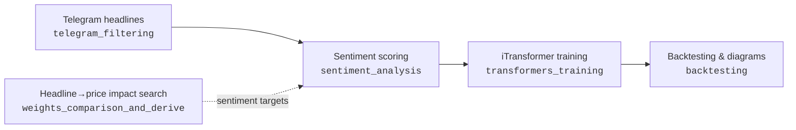

# "Price Derived Sentiment Labels from News Headlines for Bitcoin Forecasting with Multivariate Transformers" — Research Code

Source code, notebooks and data accompanying our paper on whether news/Telegram
**headline sentiment** improves short-horizon Bitcoin price prediction and trading
performance, compared with price- and technical-indicator-only models.

The pipeline:



A separate study (`weights_comparison_and_derive`) searches for the best
headline-to-price impact parameters used to build the sentiment training targets.

> **Disclaimer.** This is academic research, not financial advice. The sentiment
> notebooks under `sentiment_analysis/` are *consultative* (see "Notes" below):
> they were used for exploration and may not exactly reproduce the reported
> experiments.

---

## Repository structure

| Path | Pipeline step | Contents |
|------|---------------|----------|
| `telegram_filtering/` | 1. Headline preparation | `filter.ipynb` cleans raw Telegram exports (`result*.json`) into headline datasets (`cleaned*.csv`, `headlines.csv`). |
| `weights_comparison_and_derive/` | 2. Headline→price impact search | `weights_derive.ipynb` derives the price-impact parameters from `BTCUSDT.csv` / `output.csv` / `ok.csv`. |
| `sentiment_analysis/` | 3. Sentiment models | Sandbox notebooks for FinBERT, Finance-Qwen and TF-IDF (SVM/GBR), plus `sentiment_dataset_from_finbert.ipynb` that produces the predicted-sentiment dataset. |
| `fine_tuned_BERT/` | 3. (model + example) | The fine-tuned FinBERT model, a clean scoring notebook, and a `README.md` describing how to run it. |
| `transformers_training/` | 4. iTransformer training | Four notebooks training the time-series model on different feature sets: `price_only`, `technicals_only`, `sentiment_only`, `full_dataset`. |
| `backtesting/` | 5. Backtesting & diagrams | Refactored backtesting notebooks + helper modules (`data_loader.py`, `backtest_functions.py`, `model_utils.py`, `utils.py`), input data in `data/`, and results in `backtest_results/`. |
| `scripts/` | — | Helpers to download/upload the large files hosted outside Git. |

### Backtesting feature variants

`backtesting/` contains one notebook per feature set, mirrored by the
`backtest_results/<variant>/` output folders:

- `backtesting-price-only-refactored.ipynb` → `backtest_results/price_only/`
- `backtesting-technicals-only-refactored.ipynb` → `backtest_results/technicals_only/`
- `backtesting-sentiment-only-refactored.ipynb` → `backtest_results/sentiment_only/`
- `backtesting-full-refactored.ipynb` → `backtest_results/full_dataset/`
- `backtesting_diagrams.ipynb` → produces the comparison plots from all results.

Each variant runs three strategies (`threshold`, `momentum`, `risk_based`) over
two validation periods (`-1`, `-2`).

---

## Data & model files (hosted outside Git)

Three files exceed GitHub's 100 MB per-file limit and are **not** stored in this
repository. They are hosted on the **Hugging Face Hub** instead:

| File (repo-relative path) | Size | Hosted at | Description |
|---------------------------|------|-----------|-------------|
| `fine_tuned_BERT/fine-tuned-finbert.pth` | ~419 MB | [model: Kosmosas/BERT-bitcoin-sentiment](https://huggingface.co/Kosmosas/BERT-bitcoin-sentiment) | Fine-tuned FinBERT sentiment-regression weights. |
| `backtesting/data/BTCUSDT-last.csv` | ~393 MB | [dataset: …-assets](https://huggingface.co/datasets/Kosmosas/BERT-bitcoin-sentiment-assets) | 1-minute BTCUSDT OHLCV+volume (extended; used by backtesting). |
| `weights_comparison_and_derive/BTCUSDT.csv` | ~363 MB | [dataset: …-assets](https://huggingface.co/datasets/Kosmosas/BERT-bitcoin-sentiment-assets) | 1-minute BTCUSDT OHLCV+volume (used by the impact-parameter study). |

> The two `BTCUSDT*.csv` files look alike but are **different** snapshots
> (different row counts / date ranges) — keep both.

### Download

```bash
pip install huggingface_hub
python scripts/download_assets.py
```

Files land at their correct in-repo locations so the notebooks find them via
their existing relative paths.


## Setup

```bash
python -m venv .venv && source .venv/bin/activate
pip install -r requirements.txt
python scripts/download_assets.py   # fetch the large files (see above)
```

Open the notebooks in **VS Code** (with the Jupyter extension) or a local
**Jupyter** server. A CUDA-capable GPU is **required** for the FinBERT and
iTransformer notebooks.

---

## Notes

- **Consultative notebooks.** The `sentiment_analysis/` sandboxes (and parts of
  `transformers_training/`) were modified over time while experimenting with
  parameters; the original run-for-run notebooks were not all preserved, so they
  illustrate the approach rather than reproduce exact numbers.
- **Colab origins.** Some sentiment notebooks contain
  `from google.colab import drive` and reference `/content/drive/...` paths —
  they were run on Google Colab and need their paths adjusted to run locally.
- **Fine-tuned FinBERT.** See [`fine_tuned_BERT/README.md`](fine_tuned_BERT/README.md)
  for a minimal example of scoring new text with the fine-tuned model.

---

## Citation

If you use this code or data, please cite the accompanying paper:

```bibtex
@article{TODO_citation_key,
  title   = {TODO: paper title},
  author  = {TODO: authors},
  journal = {TODO: venue},
  year    = {TODO},
  doi     = {TODO}
}
