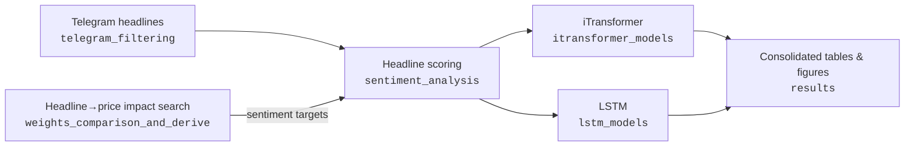

# "Price Derived Sentiment Labels from News Headlines for Bitcoin Forecasting with Multivariate Transformers" — Research Code

Source code, notebooks and data accompanying our paper on whether news/Telegram
**headline sentiment** improves short-horizon Bitcoin price prediction and trading
performance, compared with price- and technical-indicator-only models.

The pipeline:



`weights_comparison_and_derive` searches for the headline-to-price impact
parameters used to build the sentiment training targets; `sentiment_analysis`
turns headlines into a continuous market-impact score; the two forecasting
folders consume that score and produce the manuscript's forecasting and
backtesting numbers.

> **Disclaimer.** This is academic research, not financial advice.

---

## Repository structure

| Path | Pipeline step | Contents |
|------|---------------|----------|
| `telegram_filtering/` | 1. Headline preparation | `filter.ipynb` cleans raw Telegram exports (`result*.json`) into headline datasets (`cleaned*.csv`, `headlines.csv`). |
| `weights_comparison_and_derive/` | 2. Headline→price impact search | `weights_derive.ipynb` derives the price-impact parameters from `BTCUSDT.csv` / `output.csv` / `ok.csv`, and runs the label diagnostics. |
| `sentiment_analysis/` | 3. Headline scoring | Out-of-fold FinBERT scoring (`oof_finbert_scoring.ipynb`, `oof_score_full_stream.ipynb`) plus the development-stage sandboxes: FinBERT, Finance-Qwen and the TF-IDF (SVM/GBR) baselines. |
| `fine_tuned_BERT/` | 3. (model + example) | The released fine-tuned FinBERT model, a clean scoring notebook and a `README.md`. |
| `itransformer_models/` | 4. iTransformer | Training, backtesting and diagram notebooks, plus `itransformer_common.py`. |
| `lstm_models/` | 4. LSTM | The same study with a stacked LSTM; `lstm_common.py` holds the protocol both families share. |
| `backtesting/` | — | Trading-strategy implementations (`backtest_functions.py`), the data-loading conventions (`data_loader.py`) and all input data under `data/`. |
| `results/` | 5. Consolidation | `make_results.py` collects both model families into the tables and figures the manuscript reports; `make_dm_tables.py` writes both Diebold–Mariano tables in one uniform format. |
| `diagnostics/` | — | Read-only scripts that re-derive the methodological claims the manuscript makes (what is trainable in the scoring model, how inputs are normalised, training-interval and sequence counts, in-sample share of the strategy search). See `diagnostics/README.md`. |
| `scripts/` | — | Helpers to download/upload the large files hosted outside Git. |

Both forecasting folders run the same three strategies (`threshold`,
`risk_based`, `momentum`) over the same two held-out periods (`-1` uptrend, `-2`
sideways), and import those strategies from
`backtesting/backtest_functions.py`, so the two families are evaluated by
literally the same code. See `itransformer_models/README.md` and
`lstm_models/README.md` for the shared protocol and each folder's outputs.

---

## Data & model files (hosted outside Git)

Three files exceed GitHub's 100 MB per-file limit and are **not** stored in this
repository. They are hosted on the **Hugging Face Hub** instead:

| File (repo-relative path) | Size | Hosted at | Description |
|---------------------------|------|-----------|-------------|
| `sentiment_analysis/oof_checkpoints/finbert_oof_tone3_cond_fold{1..6}.pth` | ~419 MB each | [model: Kosmosas/BERT-bitcoin-sentiment](https://huggingface.co/Kosmosas/BERT-bitcoin-sentiment) | Out-of-fold FinBERT weights — the current headline scorer. **Fold 6 is the one to use**; it covers the paper's evaluation window. |
| `fine_tuned_BERT/fine-tuned-finbert.pth` | ~419 MB | [model: Kosmosas/BERT-bitcoin-sentiment](https://huggingface.co/Kosmosas/BERT-bitcoin-sentiment) | The superseded single checkpoint. Kept because the paper reports an in-sample comparison against it. |
| `backtesting/data/BTCUSDT-last.csv` | ~393 MB | [dataset: …-assets](https://huggingface.co/datasets/Kosmosas/BERT-bitcoin-sentiment-assets) | 1-minute BTCUSDT OHLCV+volume (extended; used by forecasting and backtesting). |
| `weights_comparison_and_derive/BTCUSDT.csv` | ~363 MB | [dataset: …-assets](https://huggingface.co/datasets/Kosmosas/BERT-bitcoin-sentiment-assets) | 1-minute BTCUSDT OHLCV+volume (used by the impact-parameter study). |

> The two `BTCUSDT*.csv` files look alike but are **different** snapshots
> (different row counts / date ranges) — keep both.

The two comparison runs of the out-of-fold scorer (`finbert_oof_tone3_*` and
`finbert_oof_cls_*`, ~4 GB) are not published; rerun `oof_finbert_scoring.ipynb`
with the matching `RUN_TAG` to rebuild them.

### Download

```bash
pip install huggingface_hub
python scripts/download_assets.py           # the price CSVs and the old checkpoint
python scripts/download_assets.py --all     # plus the 2.5 GB of out-of-fold weights
```

Files land at their correct in-repo locations so the notebooks find them via
their existing relative paths. The out-of-fold checkpoints are skipped by default
— the scores they produced are committed under `backtesting/data/cleaned/`, so
they are only needed to re-score headlines from scratch.

## Setup

```bash
python -m venv .venv && source .venv/bin/activate
pip install -r requirements.txt
python scripts/download_assets.py   # fetch the large files (see above)
```

Open the notebooks in **VS Code** (with the Jupyter extension) or a local
**Jupyter** server. Run each folder's notebooks from inside that folder — they
resolve their inputs and outputs relative to the working directory. A
CUDA-capable GPU is **required** for the FinBERT, iTransformer and LSTM
notebooks.

---

## Environment and seeds

The environment the reported results were produced in is pinned in
[`requirements.txt`](requirements.txt): Python 3.12.3, `torch` 2.13.0+cu130,
`transformers` 5.15.0, on Linux (glibc 2.39) with an NVIDIA RTX 3060 (12 GB),
driver 595.71.05, CUDA 13.0.

The headline scorer is `yiyanghkust/finbert-tone` at revision
`4921590d3c0c3832c0efea24c8381ce0bda7844b`. That checkpoint ships no
`tokenizer_config.json` or `tokenizer.json` — only `config.json`,
`pytorch_model.bin` and `vocab.txt` — so the tokenizer (WordPiece, uncased,
30,873 tokens) is constructed from `transformers` defaults. Its behaviour is
therefore tied to the pinned `transformers` version. The calls in the notebooks
do not pass `revision=`; they resolve to whatever `main` points at, so pin it
explicitly if you re-run them.

### Seeds that are set

| Stage | Where | Seed | What it controls |
|---|---|---|---|
| Out-of-fold FinBERT scoring | `sentiment_analysis/oof_finbert_scoring.ipynb` | `SEED = 42` | head initialisation (`torch.manual_seed`) and per-epoch batch shuffling (`torch.Generator`) |
| Out-of-fold scoring, full stream | `sentiment_analysis/oof_score_full_stream.ipynb` | `SEED = 42` | model construction |
| iTransformer training | `itransformer_models/01_itransformer_training.ipynb` | `SEEDS = [0, 1, 2]` | one model per seed; each seeds `torch`, `numpy` and the loader generator |
| LSTM training | `lstm_models/01_lstm_training.ipynb` | `SEEDS = [0, 1, 2]` | as above |
| Matched-training robustness check | `itransformer_models/matched_training_check.py` | `SEEDS = [0, 1, 2]` | as above |
| iTransformer hyperparameter search | `itransformer_common.py` (`tune`, default) | `TPESampler(seed=0)` | Optuna sampler |
| LSTM hyperparameter search | `lstm_models/01_lstm_training.ipynb` | `TPESampler(seed=0)` | Optuna sampler |
| Shuffled-forecast control | `*/02_*_backtesting.ipynb` | `default_rng(0)` | the permutation of the forecast used as a no-signal control |
| Impact-parameter study | `weights_comparison_and_derive/weights_derive.ipynb` | `random_state=13` | the train/test split |

Tables report the mean ± standard deviation over the three training seeds; the
backtest signal is the seed-averaged forecast.

### What is not reproducible, and why

| Component | Reason |
|---|---|
| **Backtest strategy search** | A seed reaches the sampler, but `02_*_backtesting.ipynb` sets `N_JOBS = 8`, and Optuna's TPE is not deterministic under parallelism. Set `N_JOBS = 1` for a reproducible, much slower search. See [`results/README.md`](results/README.md) for the measured size of the effect. |
| **Exact training runs** | `torch.backends.cudnn.deterministic` and `torch.use_deterministic_algorithms` are not set, so GPU kernel scheduling makes runs non-bit-identical even at a fixed seed. Seed-to-seed spread is reported alongside every forecasting number. |
| **Single-checkpoint FinBERT scores** | `predicted_sentiments_finbert.csv` came from `sentiment_analysis/FinBERT sandbox.ipynb`, which shuffles with `DataLoader(shuffle=True)` and sets no seed. The committed CSV is the artefact of record; it cannot be regenerated exactly. The out-of-fold scores that supersede it *are* seeded. |
| **Finance-Qwen sandbox** | Same — `DataLoader(shuffle=True)`, no seed. Those scores never feed the forecasting stage. |
| **TF-IDF SVM / GBR baselines** | The `train_test_split(..., random_state=42)` lines are commented out and the estimators carry no `random_state`. |

---

## Notes

- **Reproducibility of the backtests.** The strategy searches call
  `study.optimize(..., n_jobs=8)`; Optuna's TPE sampler is not deterministic
  under parallelism even with a fixed seed, so backtest point estimates carry
  search noise. See `results/README.md` for the measured size of that effect.
- **Sandbox notebooks.** The development-stage notebooks in
  `sentiment_analysis/` were modified over time while experimenting with
  parameters; the original run-for-run versions were not all preserved, so they
  illustrate the approach rather than reproduce exact numbers. The out-of-fold
  scoring notebooks in the same folder are the ones that produce the reported
  headline scores.
- **Colab origins.** Some sandbox notebooks contain
  `from google.colab import drive` and reference `/content/drive/...` paths —
  they were run on Google Colab and need their paths adjusted to run locally.
- **Fine-tuned FinBERT.** See [`fine_tuned_BERT/README.md`](fine_tuned_BERT/README.md)
  for a minimal example of scoring new text with the fine-tuned model.

---

## Citation

If you use this code or data, please cite the accompanying paper:

```bibtex
@article{bdcc10090309,
    AUTHOR = {Mažeika, Povilas and Paulavičius, Remigijus and Filatovas, Ernestas},
    TITLE = {Price-Derived Headline Market-Impact Labels for Bitcoin Forecasting with Multivariate Transformers},
    JOURNAL = {Big Data and Cognitive Computing},
    VOLUME = {10},
    YEAR = {2026},
    NUMBER = {9},
    ARTICLE-NUMBER = {309},
    URL = {https://www.mdpi.com/2504-2289/10/9/309},
    ISSN = {2504-2289},
    DOI = {10.3390/bdcc10090309}
}
```
